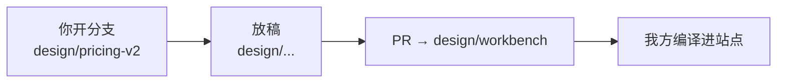

# 前端设计稿分支（design/workbench）

这个分支给**非研发同学**做前端设计稿用。你在这里用任何工具、随便怎么发挥都可以，不影响产品代码、不碰数据库、不会有人因为你风格不合规范而退回。

你只需要读这一个文件。**如果你用的 AI 编码工具支持 skill，请先让它加载 `noumi-design` skill**（`.agents/skills/noumi-design/SKILL.md`）——那是写稿时的详细规范：产出位置、设计 token、字体、断点、交互标注、禁止项、自查清单。

---

## 1. 一句话流程

1. 从 `design/workbench` 开一个分支，比如 `design/pricing-v2`。
2. 把设计稿放进 `design/` 目录（放哪见第 3 节）。
3. 提交、发 PR，**目标分支选 `design/workbench`**（不要选 `main`）。
4. 我们合进去后，会把它编译进正式站点；你不需要再做任何事。



## 2. 怎么提交：不需要安装任何东西

- **推荐**：直接在 `github.com` 网页上操作。在你的分支页面里点 `Add file → Upload files`，把文件拖进去，填一句说明，提交。再点 `Compare & pull request`。
- 也可以用你顺手的任何 Git 客户端。这不重要。
- **你不需要安装** Node、Bun、pnpm 或任何项目依赖。你不需要 `.env`，不需要拿到任何密钥，也不要向我们索要密钥。
- **这个分支里没有产品代码，也不需要你去碰产品代码。** 你只要产设计稿。
- **但可以读 `main` 分支的一部分源码**（样式、导航/页脚、既有页面 HTML、字体表）来对齐视觉逻辑，见第 5 节。
- 也不要往本分支添加任何代码文件（`.js` / `.ts` / `.tsx` / `.vue` / `package.json` 等），或者新建工程脚手架。这里只放 HTML、CSS、图片和文档。

## 3. 交付单位：整页 / 区块 / 片段

稿子不完整是完全正常的。按你的完成度选一种，放到对应目录：

| 完成度 | 放哪里 | 例子 | 我们的落地方式 |
| --- | --- | --- | --- |
| 一个完整页面 | `design/pages/<路由名>.html` | `design/pages/pricing.html` | 编译成整页，套上站点的导航和页脚 |
| 页面里的一段 | `design/sections/<名字>.html` | `design/sections/home-showcase.html` | 编译成区块，插到指定页面的位置 |
| 页面里的一小块 | `design/fragments/<名字>.html` + 同名 `.css` | `design/fragments/cta-banner.html` | 编译成小组件，由研发插到页面里 |

图片、字体、视频放 `design/assets/`，用相对路径引用，例如 `../assets/hero.png`。

**只做一个按钮、一张卡片也是合格的交付。** 不需要为了"完整"去把整页补全。

参考：`design/pages/_example.html` 是一个可以直接照抄的最小例子（下划线开头的文件不会被编译，随便你拿去改）。

## 4. 稿子长什么样才对

用你顺手的工具做，但**提交时请附上渲染后的 HTML、它用到的 CSS、以及图片**。

- 你写的应该是 HTML/CSS 本身。快做完时，在浏览器里"查看源代码"或"另存为"，把结果交上来即可。
- 样式直接写在 HTML 里（`<style>` 标签）或者单独一个 `.css` 文件，两种都行。
- **只用 HTML 和 CSS。** 不要提交 `.vue`、`.jsx`、`.tsx`、`.svelte` 这类源文件——它们在我们这里是跑不起来的，语义会丢失。你用的工具是自由的（Framer、v0、Figma 导出、手写都行），我们只接收它渲染出来的 HTML/CSS/图片。
- 页面里只写**导航栏和页脚之间**的那部分内容。**不要自己写导航栏、页脚、Cookie 弹窗、分析脚本**——这些站点会自动套上去。
- 需要在 `<head>` 里写 `<title>` 和 `<meta name="description">`，我们会把它用作 SEO 信息。

### 配色和字体请对齐现有站点

不需要你凭空发明一套主题。**本分支里没有站点的样式文件**，实际生效值已经整理在 skill 里（`.agents/skills/noumi-design/SKILL.md`），直接抄即可：

```css
--noumi-paper: #f5f3ee;  /* 页面底色 */
--noumi-lite: #fcfaf3;   /* 浅背景块 */
--noumi-dark: #3b3f43;   /* 正文文字 / 深色页脚 */
--noumi-blue: #4d72c2;   /* 强调色 / 链接 / 按钮 */
--noumi-muted: #6e86a4;  /* 次要文字 */
--noumi-line: rgba(59, 63, 67, 0.16);
--ff-display: 'Noto Serif SC', Georgia, serif;   /* 标题 */
--ff-body: 'Noto Sans SC', system-ui, sans-serif; /* 正文 */
```

（`--cream` / `--ink` / `--accent` 是同一批颜色的别名，值完全相同。）

字体优先用 `var(--ff-display)` / `var(--ff-body)`；需要英文时 `Inter` 与 `Funnel Display` 站点也已内置。**不要引入外部字体。**
响应式断点用 `960px` / `760px` / `600px`。完整规范（含实测字号、容器宽度、自查清单）见 `.agents/skills/noumi-design/SKILL.md`。

需要核对源码时，样式文件在产品仓库 `main` 分支上（见第 5 节链接），只读。

## 5. 参考现有界面

想对齐已有页面，最省事的办法是**对着线上站点看**：<https://noumi.ai>

### 建议先拉一份只读参考（推荐）

**想让新稿子看起来和站点是一套东西，读现有样式是最快的办法。** 本分支没有代码，用这个脚本按白名单拉一份只读快照：

```bash
bash tools/fetch-main-styles.sh          # 输出到 .main-reference/（已在 .gitignore 里）
```

它会从产品仓库 `main` 分支取出样式文件、`SiteHeader`/`SiteFooter`、`pages.json`（24 个既有页面的真实 HTML）、字体表等，**只读、不提交**。也可以单独取一个文件：

```bash
git fetch --depth=1 origin main
git show origin/main:"src/app/(frontend)/prototype-parity.css"
```

**允许看的范围**（视觉与 DOM，够理解机制）：`src/app/(frontend)/**/*.css`、`src/components/site/Site{Header,Footer}.tsx`、`src/components/site/official/OfficialPersistentChrome.tsx`、`src/components/site/official/OfficialContentSections.tsx`、`src/lib/site/prototype/*.json`、`public/assets/fonts/fonts.css`。

**不用看、也别在 PR 里引用的**：CMS collections/globals、`access/`、`lib/site/official-cms.ts`、`payload.config.ts`、`worker.ts`、`wrangler.jsonc`、迁移、`.github/`。这些与视觉无关。

**读的时候重点看**：类名前缀习惯（`redesign-*` / `official-*` / `page-hero`）、变量怎么组合（`var(--noumi-blue)` 而不是写死色值）、响应式写法（同一选择器在 960/760/600 各做什么）、间距/圆角取值习惯（多为 5 的倍数）、状态（`:hover` / `:focus-visible` / `[aria-current]`）。

**注意边界**：参考快照是"现状"，不是可以照抄的模板——不要拷整份现有 CSS 进 `design/`，不要改写现有全局规则，不要新增 CSS 框架/预处理器，也不要新建全局样式文件。

### 只想看具体文件时

可以直接点 GitHub 上 `main` 分支的链接（**本分支里没有这些文件，只读**）：

- [`official-base.css`](https://github.com/langcore-ai/noumi-official-website/blob/main/src/app/(frontend)/official-base.css)：站点共享样式与设计变量
- [`official-home.css`](https://github.com/langcore-ai/noumi-official-website/blob/main/src/app/(frontend)/official-home.css)：主题变量定义
- [`prototype-parity.css`](https://github.com/langcore-ai/noumi-official-website/blob/main/src/app/(frontend)/prototype-parity.css)：**最终生效值（配色以此为准）**
- [`prototype-pages.css`](https://github.com/langcore-ai/noumi-official-website/blob/main/src/app/(frontend)/prototype-pages.css)：原型页适配
- [`SiteHeader.tsx`](https://github.com/langcore-ai/noumi-official-website/blob/main/src/components/site/SiteHeader.tsx) / [`SiteFooter.tsx`](https://github.com/langcore-ai/noumi-official-website/blob/main/src/components/site/SiteFooter.tsx)：站点自带的导航与页脚（你不用写，但知道它们长什么样有好处）
- [`OfficialContentSections.tsx`](https://github.com/langcore-ai/noumi-official-website/blob/main/src/components/site/official/OfficialContentSections.tsx)：现有内容区块的写法参考

不需要读懂 React，看 CSS 和 HTML 结构就够了。**当前生效的设计值已经整理在 skill 里**（`.agents/skills/noumi-design/SKILL.md`），多数情况不用去翻源码。

## 6. 请不要做这些

- 不要改动 `design/` 目录以外的任何文件——本分支上本来也没有别的文件。特别是不准在本分支新建工程脚手架、`package.json`、`src/`、`.github/`。
- 不要把 `.main-reference/` 或任何从 `main` 拉下来的文件提交上来（已在 `.gitignore` 里）；也不要把现有整份 CSS 拷进 `design/`，或改写已存在的全局规则（`.page-body` / `.site-header` / `.site-footer` / `:root`）。
- 不要提交 `<script>` 标签或任何可执行代码。纯 CSS 的 `:hover` / `transition` / `@keyframes` 可以写（务必配 `prefers-reduced-motion` 降级）；需要 JS 才能做的效果（滚动入场、指针跟随、轮播等）请在 PR 描述里说明"哪个元素、什么时机、动什么"，由我们实现。
- 不要用外链资源（其他网站的图片、CDN、字体、视频链接）。图片请放进 `design/assets/`。
- 不要写 `position: fixed` 的全屏覆盖层。
- 不要自己写导航栏、页脚、登录表单。
- 单次提交的图片总量控制在 8MB 以内；更大的素材先找我们。
- 不要粘贴任何真实密钥、内部数据或未公开的用户信息。

## 7. 怎么看效果

- 只看视觉：在本地用浏览器打开你写的 HTML 就行，加个手机宽度对比一下。
- 想让本地预览也带上站点的真实样式（变量、字体、间距），把 `tools/fetch-main-styles.sh` 拉下来的快照样式表按顺序临时挂到 `<head>` 里，具体见 skill 第 0 节——**这只是给你本地看的，不要提交进稿子**。
- 想看**套上真实导航/页脚、在真实 URL 下**的效果：发 PR 后我们会把预览链接贴在 PR 评论里。
- 预览链接只是给你看效果的，不会影响正式站点。

## 8. 有疑问

在 PR 里直接 @ 我们，或者把问题写进 PR 描述。设计上的事没有"错"，只有"能不能落地"，我们会给具体改法。

---

## 给我们自己看的部分

- **本分支是孤立分支（orphan），与 `main` 没有共同历史、没有产品代码**，只有十几个文件。目的：vibecoding agent 打开仓库时看到的是纯设计上下文，不会被 `src/` 里 700 多个文件、Payload 规则、CI 配置带偏。
- 因此**不需要把 `main` 同步进来**（没有代码可同步）。需要维护的：skill 里的设计 token / 字体 / 断点是否还和线上一致、示例页是否还成立、第 5 节的 `main` 链接是否失效、`tools/fetch-main-styles.sh` 白名单里的路径是否还存在（`main` 上文件改名就要同步改）。
- 抽查点：`design/**` 是否夹带了代码文件或新脚手架；图片体积；是否引入 `<script>` 或外链资源；视觉是否能在站点壳层里成立。
- 编译链路复用现有 `scripts/sync-prototype-pages.mjs` 的思路（剥离 script/style/link、去掉自带 header/footer、重写资源路径、CSS 加前缀隔离）。产物落在**产品仓库**的 `src/lib/site/design/` 与 `public/assets/design/`，**线上只读编译进 main 的产物，不读本分支**。
- 本分支不接生产密钥、不参与部署，也不应配置任何 CI secret。设计稿的最坏影响范围是页面版式。
